<div align="center">

<picture>
  <source media="(prefers-color-scheme: dark)" srcset="assets/readme/hero-escuro.svg">
  
</picture>

</div>

# Heild

**Heild** vem do islandês *heild*: o inteiro, o todo sem partes separadas. A raiz é o nórdico antigo *heill*, inteiro. É um sistema que junta num lugar só as ferramentas de uma empresa (painel, CRM com WhatsApp, timesheet, financeiro, arquivos, app do cliente) com um time de integrantes de IA, um para cada área. Os integrantes preparam o trabalho, e uma pessoa aprova.

Este repositório é o controlador geral da marca: a identidade, o design system, o site e o sistema interativo de demonstração. Cada parte mora no seu branch, com a sua documentação.

## Os branches

| Branch | O que tem | Comece por |
|---|---|---|
| [`main`](../../tree/main) | Este hub, a visão geral, o fluxo de trabalho e as ferramentas do README | este arquivo e [`docs/`](docs) |
| [`design-system`](../../tree/design-system) | A marca: cores, tipografia, forma, gradientes, logo animada (`<heild-logo>`), fontes, logos estáticas, orbs e tokens | `design-system/README.md` |
| [`prototipo`](../../tree/prototipo) | O sistema wireframe interativo: Início com o Assistente e o time, Painel, CRM, Timesheet, Financeiro, BPO, Arquivos, app do cliente, configurações | `app/README.md` |
| [`site`](../../tree/site) | O site e as landing pages (principal, Heild Contábil, Heild BPO, contato), construído sobre os componentes do protótipo | `app/src/site/README.md` |
| [`gh-pages`](../../tree/gh-pages) | Só o build estático do site, servido pelo GitHub Pages. Gerado a partir do `site`; não se edita à mão | `README.md` do branch |

O `site` nasce do `prototipo`: a demonstração da landing roda o produto de verdade (a mesma loja, os mesmos fluxos, os mesmos cartões), então os dois dividem o código do app. O mapa completo está em [`docs/branches.md`](docs/branches.md).

## O time

<picture>
  <source media="(prefers-color-scheme: dark)" srcset="assets/readme/time-escuro.svg">
  
</picture>

Cada integrante é um membro de IA do time, com chat, fila e memória próprios. A cor do orb é dele e só aparece no orb e nos marcadores do mesmo integrante. O Assistente recebe qualquer pedido e divide entre os outros; o Consultor responde sobre a lei com o artigo, a data e o grau de segurança.

- **Contábil:** Fiscal, DP, Contábil, Societário, Notas.
- **BPO:** Contas a Pagar, Contas a Receber, Conciliação, Gerencial.
- **De todas as áreas:** Atendimento, Financeiro.

Transmitir, pagar, assinar e enviar ao cliente sempre passam por um cartão de aprovação, com o nome de quem aprovou.

## A marca, em uma tela

<picture>
  <source media="(prefers-color-scheme: dark)" srcset="assets/readme/areia-escuro.svg">
  
</picture>

- **Tudo, num lugar só.** A logo é modular: o I fica sozinho entre HE e LD e se transforma em cada coisa (grade, orb, barras, check), depois volta a ser uma pílula.
- **Areia.** Todo neutro sai de uma escala só, de `areia-50` a `areia-950`. A interface é feita de camadas dessa areia.
- **Um destaque.** O índigo `#4f5bf5` é a única cor de marca fora da areia, em pontos pequenos.
- **Claro e escuro valem o mesmo.** O produto oferece os dois; o site segue a preferência da pessoa.
- **PP Neue Montreal**, em dois cortes: a Neue Montreal para títulos, a Text para a interface.

O livro da marca completo está no branch [`design-system`](../../tree/design-system).

## Como trabalhar aqui

- Português do Brasil em tudo: código, comentários, commits e documentos.
- Cada mudança vai para o branch da parte que ela muda. O `main` só recebe o que é de todos (este hub, `docs/`, as ferramentas do README).
- Commits pequenos, com mensagem que diz o que mudou e por quê.
- Nada inventado: a Heild ainda não foi lançada, então não há clientes, números de uso ou depoimentos para mostrar.

As redes sociais (Instagram e Facebook) têm um design system de posts próprio, os modelos, o render e os posts prontos em [`redes-sociais/`](redes-sociais), com o plano editorial em [`docs/planos/Plano_Redes_Sociais.md`](docs/planos/Plano_Redes_Sociais.md).

Os detalhes (como rodar cada parte, como publicar, como refazer as imagens deste README) estão em [`docs/fluxo-de-trabalho.md`](docs/fluxo-de-trabalho.md).

## As imagens deste README

São SVGs animados em SMIL, gerados por [`ferramentas/gerar_svgs_readme.py`](ferramentas/gerar_svgs_readme.py) a partir dos traçados reais da logo ([`ferramentas/wordmark.json`](ferramentas/wordmark.json)) e das cores do design system. Cada uma tem a versão clara e a escura, e o GitHub escolhe pela preferência de quem lê.

```bash
python3 ferramentas/gerar_svgs_readme.py
```
